## Uebung05

### Aufgabe 1: Einkomponenten Übergang → Logik-Hazard: statischer Hazard → Fehlfunktion — Logik-Hazard beseitigen

`FeedbackMux Architecture`
```vhdl
  Yc <= Yn;
  
  nEn   <= not(iEn)       after 6 ns;

  -- prime implicands
  Impl1 <= iEn and iD     after 5 ns;
  Impl2 <= Yc and nEn     after 5 ns;

  -- combine prime implicands
  Yn    <= Impl1 or Impl2 after 5 ns;

  oQ <= Yc;
 ``` 
 
Im bereitgestellten Code wird das `after` keyword verwendet, dass implizit das intertial Modell verwendet. Das bedeutet Impulsr kürzer als die Zeit werden nicht übernommen. Dadurch kann es zu Hazards kommen, wenn diese Zeit verletzt wird bzw. nicht eingehalten wird.

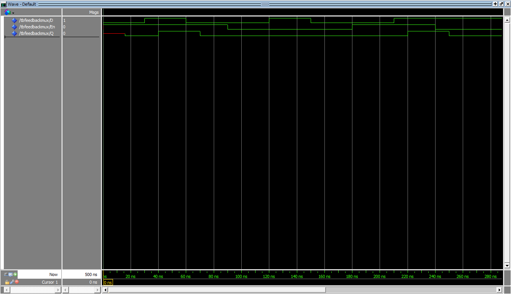

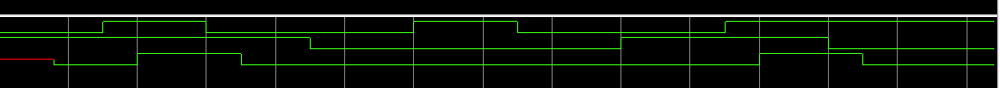

Hier kann man erkennen, dass bei 240ns das Latch eigentlich den Wert von D in Q speichern sollte, das Q aber etwas verzögert, nachdem iEn auf 0 geht, sich zurücksetzt.

Das Problem ist, dass Impl2 erst nach 11ns ankommt, aber Impl1 schon nach 5ns ankommt. Deshalb schaltet das Yn auf 0 bevor der 2. Primimplikant ausgewertet werden kann. **Es ist quasi so, als würde der 2. PI nicht existieren.** Und weil ja eine Rückkopplung existiert, überschreibt Yn das Yc sofort ohne Verzögerung und der 2. Primimplikant kommt nie an.

`Variierung nEn und Impl1`
| Nr | Fall | Verzögerungen | Was passiert? |
|---|---|---|---|
| 1 | Impl1 < nEn | nEn = 6 ns, Impl1 = 5 ns | Hazard: Ausgangsszenario |
| 2 | Impl1 > nEn | nEn = 6 ns, Impl1 = 7 ns | **Funktioniert:** 11 - 7 = 4ns < 5ns intertial  -> OK; PI1 bei 7, PI2 bei 11, Yn bei 16 (Yn ist aber bereits 1 daher keine Änderung)   |
| 3 | Impl1 = nEn | nEn = 5 ns, Impl1 = 5 ns | Es ensteht eine Clock. Impl1 = 0 und nEn = 1 bei 5ns. Beides wird gleichzeitig ausgeführt, die 0 wird zuerst ausgeführt und danach rechnet das OR neu. 10-5 = 5ns = 5ns intertial -> OK (Rückkopplung kommt im Vergleich zum 1. Fall zu spät) |

Die Lücke ist die Zeit, in der beide Eingänge des OR-Gatters 0 sind: Impl1 fällt nach t_Impl1 auf 0, Impl2 steigt erst nach t_nEn + 5 ns auf 1.

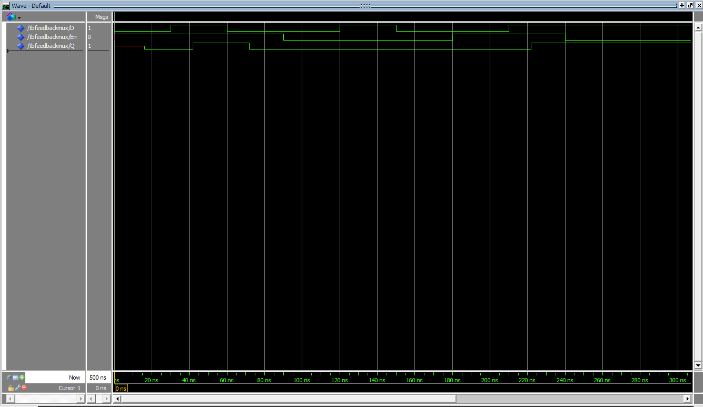
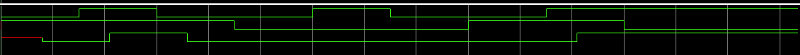

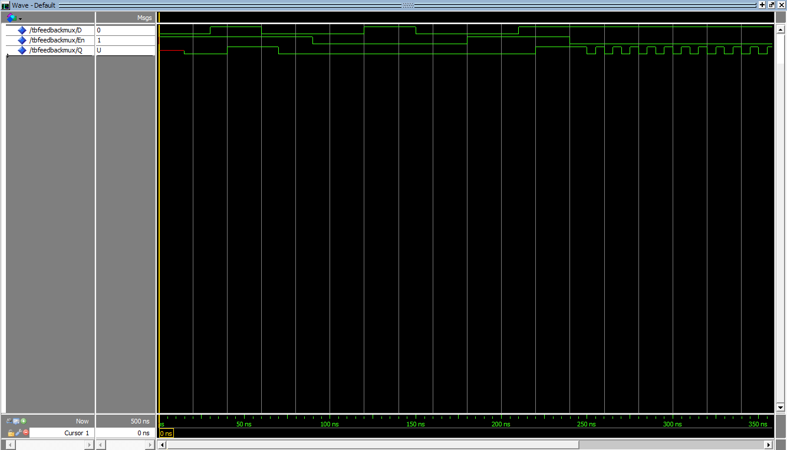
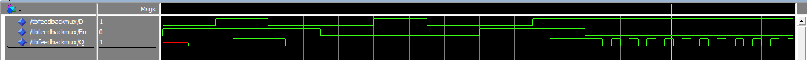


`Variierung Impl2 und Yn`

Für diese Fälle bleiben nEn = 6 ns und Impl1 = 5 ns (Ausgangsszenario), nur Impl2 und Yn werden verändert.

| Nr | Fall | Verzögerungen | nEn + Impl2 vs. Impl1 + Yn | Was passiert? |
|---|---|---|---|---|
| 4 | Impl2 schneller | Impl2 = 3 ns, Yn = 5 ns | 9 ns < 10 ns | **Funktioniert:** Impl2 ist bei 9 ns da, Yn würde erst bei 10 ns fallen. Die geplante 0 wird gelöscht -> Q bleibt 1 |
| 5 | Yn langsamer | Impl2 = 5 ns, Yn = 7 ns | 11 ns < 12 ns | **Funktioniert:** Die Lücke (5 bis 11 ns = 6 ns) ist kürzer als die Trägheit des OR (7 ns) -> wird verschluckt, Q bleibt 1 |
| 6 | Grenzfall | Impl2 = 4 ns, Yn = 5 ns | 10 ns = 10 ns | **Hazard:** Yn fällt und Impl2 steigt gleichzeitig bei 10 ns. Durch Yc = 0 fällt Impl2 schon bei 14 ns wieder, bevor Yn bei 15 ns auf 1 gehen kann -> Q bleibt 0 (keine Clock wie in Fall 3) |
| 7 | Impl2 langsamer | Impl2 = 7 ns, Yn = 5 ns | 13 ns > 10 ns | **Hazard:** wie im Ausgangsszenario, nur mit noch größerer Lücke (8 ns) -> Q = 0 |

Oben: D, Mitte: En, Unten: Q
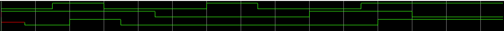

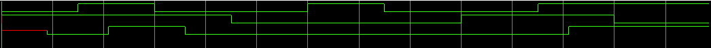

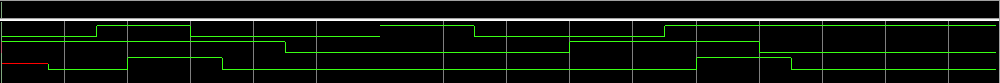

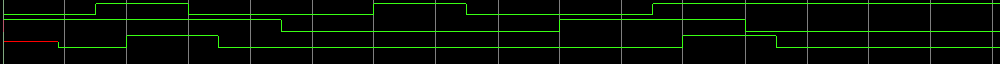

`Architecture Hazardfree`

Für Yn = f(En, D, Yc) gibt es 3 Primimplikanten. PrimImp verwendet nur 2 davon, der 3. (`D and Yc`) fehlt
```vhdl
  nEn   <= not(iEn)                after 6 ns;

  -- prime implicands
  Impl1 <= iEn and iD              after 5 ns;
  Impl2 <= Yc and nEn              after 5 ns;
  Impl3 <= iD and Yc               after 5 ns;

  -- combine prime implicands
  Yn    <= Impl1 or Impl2 or Impl3 after 5 ns;
```

Impl3 = D and Yc hängt nicht von En ab. Beim kritischen Übergang (En: 1 -> 0, D = 1, Q = 1) ist Impl3 schon 1 und bleibt 1. Es gibt also keinen Moment mehr, in dem alle Eingänge des OR 0 sind, egal wie schnell nEn, Impl1, Impl2 oder Yn sind:

| Fall | Verzögerungen (nEn / Impl1 / Impl2 / Yn) | QPrimImp | QHazardfree |
|---|---|---|---|
| 1 | 6 / 5 / 5 / 5 | Hazard, Q = 0 | Q = 1 |
| 3 | 5 / 5 / 5 / 5 | Clock | Q = 1 |
| 6 | 6 / 5 / 4 / 5 | Hazard, Q = 0 | Q = 1 |
| 7 | 6 / 5 / 7 / 5 | Hazard, Q = 0 | Q = 1 |

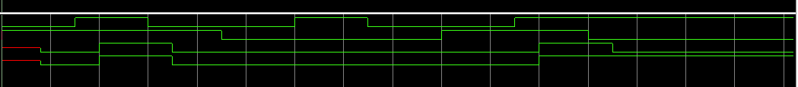

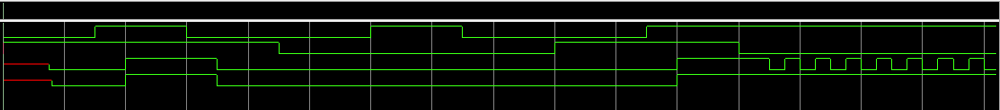

#### Kann der dritte Primimplikant die Funktion des Latches garantieren?
Ja, für Einkomponentenübergänge. Auch mit den Verzögerungszeiten, die bei PrimImp zu einem Hazard oder zu einer Clock geführt haben, speichert Hazardfree die 1 immer korrekt. Der Logik-Hazard ist beseitigt, weil jetzt alle Primimplikanten vorhanden sind.

Das gilt aber nur, solange sich nur ein Eingang ändert. Ändert sich D (fast) gleichzeitig mit En (Mehrkomponentenübergang), ändert sich auch Impl3 und die Absicherung fällt weg -> Funktions-Hazard. Außerdem muss D lange genug vor der fallenden Flanke von En stabil sein, damit Yc und Impl3 schon 1 sind. Das entspricht der Setup bzw. Hold-Zeit des Latches.


### Ausgabe 2

